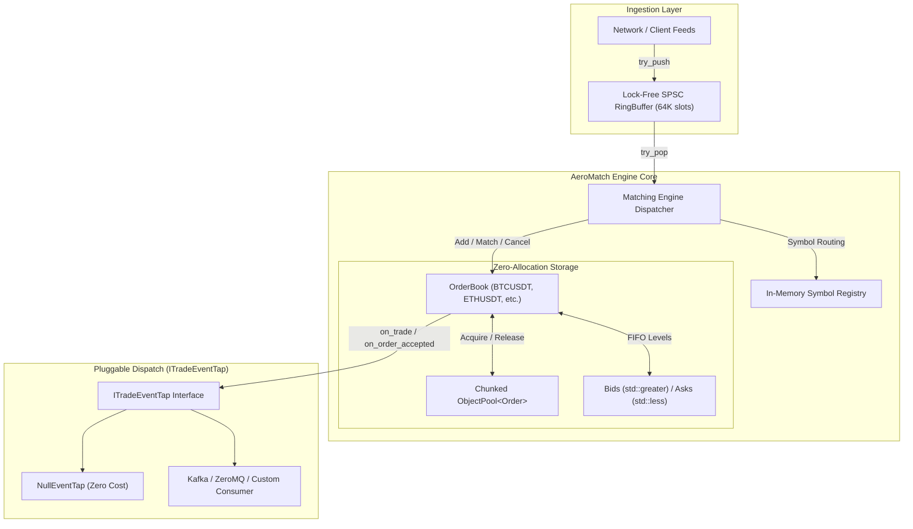

# AeroMatch

[](https://github.com/Apex-Trading-Technologies/Aeromatch/actions/workflows/ci.yml)
[](LICENSE)
[](https://en.cppreference.com/w/cpp/20)

**AeroMatch** is an ultra-low-latency, deterministic, zero-allocation C++20 limit order book (LOB) matching engine developed by **Apex Trading Technologies**. Designed for algorithmic trading desks, institutional liquidity venues, and crypto exchanges, AeroMatch processes millions of orders per second with microsecond p99 latency.

---

## Key Highlights

- **Pure C++20 Standard**: Modern, portable codebase built with zero external database dependencies (no PostgreSQL or ORMs required in core).
- **Zero-Allocation Hot Path**: Pre-allocated chunked object pool (`ObjectPool<Order>`) eliminates memory fragmentation and avoids `malloc`/`free` during execution.
- **Cache-Line Aligned**: 64-byte aligned `Order` structs minimize CPU cache misses and false sharing across cores.
- **Lock-Free Concurrency**: High-throughput Single-Producer Single-Consumer (SPSC) ring buffer enables lockless ingestion from network feed threads to the matching core.
- **Pluggable Event Decoupling (`ITradeEventTap`)**: Decoupled trade and order lifecycle dispatching—easily pipe execution data to Kafka, ZeroMQ, WebSockets, gRPC, or shared memory without altering engine internals.
- **Hulk-Grade Durability & Anti-DoS Bounds**:
  - `__uint128_t` checked arithmetic prevents integer overflow on `price * quantity` notional calculations.
  - Granular limits per symbol and per user (`max_orders_per_user_`) safeguard against memory exhaustion attacks.
  - Strict enum range validation on side, order type, and pricing parameters.

---

## Architecture Overview



---

## Performance Benchmarks

Measured on bare-metal consumer laptop hardware running Google Benchmark v1.8.3 under `-O3` release flags:
- **Processor**: Intel(R) Core(TM) i3-1005G1 (Ice Lake, 2 Cores / 4 Threads, 1.20 GHz Base / 3.40 GHz Turbo, 4 MB L3 Cache)
- **Memory**: 12 GB DDR4 (11 GiB usable)
- **OS & Toolchain**: Pop!_OS 24.04 LTS (Ubuntu-based, Linux 7.2.15 x86_64), GCC 13.3.0, C++20

| Benchmark Scenario | Measured Throughput | CPU Time / Operation | Iterations Verified |
| :--- | :--- | :--- | :--- |
| **Order Book Ingestion (Resting LIMIT)** | **22.06 Million orders/sec** | **45.3 ns** / order | 24,368,000 orders |
| **Single-Order Tick-to-Book Latency** | — | **20.6 ns** / order | 28,083,014 samples |
| **Order Crossing & Trade Execution** | **10.88 Million orders/sec** | **91.9 ns** / cross | 6,251,000 matches |
| **Crossing Round-Trip Latency** | — | **211 ns** / trade | 3,556,079 executions |
| **Zero-Allocation ObjectPool** | **206.00 Million allocs/sec** | **4.85 ns** (4.7x faster than `new`) | 120,114,868 cycles |
| **Lock-Free SPSC RingBuffer (MT)** | **86.66 Million msgs/sec** | **11.5 ns** cross-thread | 52,700,000 transfers |

All operations run with zero heap allocations on the critical path, deterministic O(1) order pool reclamation, and bounded latency.

> **Hardware Portability:** Also compiled and verified on legacy bare-metal x86-64 hardware (Dell Latitude 3330, 3rd Gen Intel Core i5-3337U Ivy Bridge, 2 Cores / 4 Threads @ 1.80 GHz, 8 GB RAM — no AVX2 required).

---

## Pluggable Event Tap (`ITradeEventTap`)

AeroMatch provides a clean interface to tap into execution events without adding dependencies:

```cpp
#include <aeromatch/event_tap.hpp>

class KafkaEventTap : public aeromatch::ITradeEventTap {
public:
    void on_trade(const aeromatch::Trade& trade) override {
        // Publish executed trade to Kafka topic
    }

    void on_order_accepted(const aeromatch::Order& order) override {
        // Record accepted resting order
    }

    void on_order_rejected(uint64_t order_id, uint8_t reason) override {
        // Handle rejection notifications
    }
};
```

---

## Quickstart & Installation

### Requirements
- Compiler: GCC 13+ or Clang 16+ (supporting C++20)
- CMake 3.20+
- Ninja or Make

### Building from Source

```bash
# Clone the repository
git clone [https://github.com/Apex-Trading-Technologies/Aeromatch.git](https://github.com/Apex-Trading-Technologies/Aeromatch.git)
cd Aeromatch

# Configure CMake with unit tests
cmake -B build -DCMAKE_BUILD_TYPE=Release -DAEROMATCH_BUILD_TESTS=ON

# Compile
cmake --build build -j$(nproc)

# Run test discovery suite
ctest --test-dir build --output-on-failure
```

### Running the Standalone Daemon

```bash
./build/aeromatch --test-run
```

### Running Benchmarks

```bash
cmake -B build -DAEROMATCH_BUILD_BENCHMARKS=ON
cmake --build build --target bench_matching bench_memory bench_queue
./build/benchmarks/bench_matching
```

---

## Docker Deployment

Build and run using the multi-stage Docker container:

```bash
docker build -t aeromatch:latest .
docker run --rm -it aeromatch:latest
```

---

## Supported Order Types

- **LIMIT**: Resting order placed into price-time priority ladder.
- **MARKET**: Immediate aggressive execution across existing resting liquidity.
- **IOC (Immediate-Or-Cancel)**: Fills available resting shares immediately; unexecuted balance is canceled.
- **FOK (Fill-Or-Kill)**: Entire order is filled immediately or rejected in full.

---

## Contributing

We welcome contributions from the quantitative finance and systems programming community! Please see [CONTRIBUTING.md](CONTRIBUTING.md) for architectural guidelines, code formatting, and pull request workflows.

---

## Security

For vulnerability disclosures and reporting procedures, refer to [SECURITY.md](SECURITY.md).

---

## License

AeroMatch Open-Source Edition is licensed under the [Apache License, Version 2.0](LICENSE).
Copyright &copy; 2026 Apex Trading Technologies.
